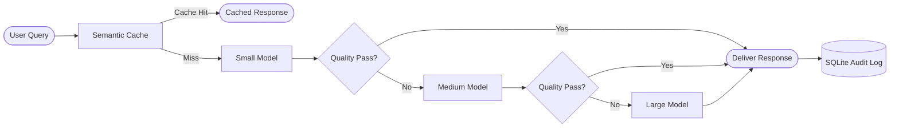

# CostGate: Cost-Aware LLM Gateway

CostGate is an intelligent LLM routing gateway built with FastAPI, SQLite, and the Google GenAI SDK. It maximizes cost efficiency for LLM workloads while ensuring answer quality using a multi-tiered waterfall escalation strategy:

1. **Semantic Cache** (0 cost, vector cosine similarity)
2. **Small Model Tier** (`MODEL_SMALL`)
3. **Medium Model Tier** (`MODEL_MEDIUM`) - escalated if small model answer quality check fails
4. **Large Model Tier** (`MODEL_LARGE`) - escalated if medium model answer quality check fails

---

## Architecture Overview



---

## Cost Accounting

Thinking/reasoning tokens returned by Gemini models must be counted as output tokens when calculating cost.

CostGate strictly calculates token expenditure as:
- **Input Cost**: `(input_tokens / 1,000,000) * price_input`
- **Output Cost**: `((output_tokens + thinking_tokens) / 1,000,000) * price_output`
- **Total Request Cost**: `Input Cost + Output Cost`

Cached responses always incur **\$0.00** cost and bypass model invocation.

---

## Project Structure

```
costgate/
├── app/                  # Gateway core service
│   ├── main.py           # FastAPI application
│   ├── config.py         # Type-safe settings loaded from .env
│   ├── schemas.py        # Pydantic request/response schemas
│   ├── llm_client.py     # Resilient Gemini SDK client (backoff, retry, timeout)
│   ├── cost.py           # Cost calculator per 1M tokens
│   ├── cache.py          # Semantic cache with cosine similarity
│   ├── quality.py        # Response quality verification
│   ├── router.py         # Waterfall routing engine
│   └── logger.py         # SQLite logging for analytics
├── eval/                 # Evaluation and benchmarking
│   ├── dataset.csv       # Test query dataset
│   ├── run_eval.py       # Benchmark evaluation script
│   └── metrics.py        # Cost & latency metrics
├── dashboard/            # Streamlit visualization
│   └── app.py            # Analytics dashboard
├── tests/                # Pytest unit & integration tests
├── .env.example          # Environment variables template
├── requirements.txt      # Dependency specification
├── Dockerfile            # Container deployment
└── README.md             # Project documentation
```

---

## Quickstart

### 1. Environment Setup
```bash
python -m venv .venv
# Windows:
.venv\Scripts\activate
# Linux/macOS:
source .venv/bin/activate

pip install -r requirements.txt
```

### 2. Configuration
Copy `.env.example` to `.env` and fill in your Gemini API key and model identifiers:
```bash
cp .env.example .env
```

### 3. Running Tests
```bash
pytest tests/ -v
```

### 4. Running the Gateway
```bash
uvicorn app.main:app --reload --port 8000
```
Interactive API documentation will be available at:
`http://127.0.0.1:8000/docs`

### 5. Running the Dashboard
```bash
streamlit run dashboard/app.py
```
